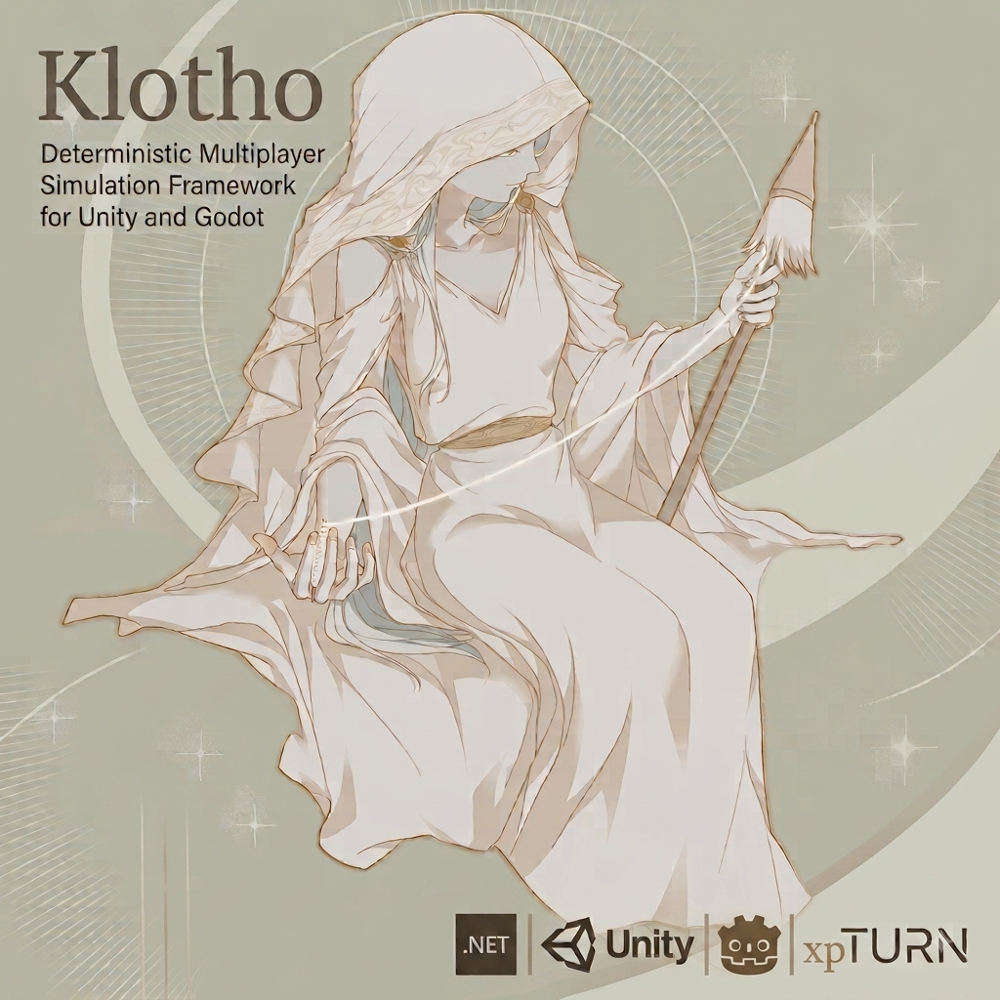

# xpTURN.Klotho
[](https://unity3d.com/get-unity/download)
[-478cbf.svg)](https://godotengine.org/download)
[](https://github.com/xpTURN/Klotho/blob/main/LICENSE)

[English](README.md) | [한국어](README.ko-KR.md) | [日本語](README.ja-JP.md) | **简体中文**

> 本文是英文 [README](README.md) 的译文。如内容有出入，以英文版为准。

**面向 Unity 与 Godot 的确定性多人模拟框架**

一个支持客户端预测（CSP）、回滚、帧同步、Server-Driven 模式和回放的确定性模拟框架。模拟核心是与引擎无关的纯 C#，其上提供 **Unity** 与 **Godot (.NET)** 适配层。框架排除浮点数，仅以 32.32 定点数（`FP64`）和确定性随机数生成器（Xorshift128+）构建模拟，因此即使平台和编译器不同，也能保证完全可复现。



> Klotho 一帧一帧地纺出模拟。

**用一段话说明同步如何工作：** 关键在于确定性——只要输入的顺序相同，每个对端都会算出逐字节相同的状态，因此网络*只传输输入*，验证也就归结为比较哈希。在此基础上，每个对端在同一条 tick 轴上维护两条时间线：**已验证（Verified）链**（所有玩家的真实输入都已知的 tick——不可变）和**预测（Predicted）链**（凭*猜测*的远端输入提前运行的 tick——暂定）。就像 CPU 的分支预测，模拟不等待，而是立即用预测的输入向前推进；当真实输入与猜测不符时，引擎恢复快照并重新模拟（**回滚**）。由于状态是输入的纯函数，这一代价很小。输入延迟和自适应时序缓冲减少回滚的发生次数；当确定性真的被破坏时，分级恢复阶梯（哈希校验 → 回滚 → 全状态重新同步 → 校正重置）会让各方重新一致。同一套机制同时服务于 **P2P 锁步**（对端拥有同等权限）和 **Server-Driven**（服务器拥有已验证链）。完整依据：[Docs/SynchronizationDesign.md](Docs/SynchronizationDesign.md)。

---

## 主要功能

| 领域 | 内容 |
| ---- | ---- |
| **网络模型** | P2P 锁步 · 回滚 + 客户端预测 · Server-Driven（权威服务器） · 专用服务器 · 观战 · 中途加入（Late Join） · 断线重连 |
| **房间与对局配置** | 多房间专用服务器 · 通过 `IMatchConfigSource` 提供按房间的关卡（`StageId`）+ 按对局的不透明配置（`MatchConfigData`）——一台服务器承载不同关卡的房间 · 大厅房间预约（连接前预约） · 向大厅上报已验证的对局结果（`IMatchResultProvider`，至少一次送达 + 幂等） |
| **确定性数学** | `FP64`（32.32 定点数） · `FPVector2/3/4` · `FPQuaternion` · `FPMatrix` · 基于 LUT/CORDIC 的三角函数 · `DeterministicRandom`（Xorshift128+） |
| **物理** | `FPPhysicsWorld` · 粗检测（SpatialGrid） · 细检测 · CCD（Sweep） · 约束求解器 · 关节 · 触发器 · 静态 BVH |
| **导航** | `FPNavMesh` · A*（三角形图） · Funnel（SSFA） · ORCA 避障 · 集成 ECS 的 `NavAgentComponent` |
| **ECS** | Sparse-set `ComponentStorage<T>` · `Frame`（单一 byte[] 堆） · `FilterWithout/Filter<T1..T5>` · `FrameRingBuffer` · `SystemRunner` |
| **AI / HFSM** | 确定性分层 FSM · `HFSMBuilder`（fluent） · `HFSMRoot` / `HFSMManager` · `HFSMComponent`（按实体） · `HFSMDecision` / `AIAction` · Unity 状态树可视化工具 |
| **序列化 / 源代码生成器** | `SpanWriter/Reader`（ref struct，无 GC） · 通过 `[KlothoComponent]` / `[KlothoSerializable]` / `[KlothoDataAsset]` / `[KlothoSerializableStruct]` 自动生成代码 · 构建时 `DeterminismAnalyzer`（标出模拟代码中的 float / 非确定性 API） |
| **数据资源** | `IDataAsset` · `DataAssetRegistry` · `DataAssetRef` · JSON 序列化（`xpTURN.Klotho.DataAsset.Json`） |
| **回放** | 录制 / 播放 / 跳转 / 变速 |
| **验证工具** | `SyncTestRunner`（GGPO 式确定性验证） · `DeterminismVerificationRunner` · 基准测试套件 |
| **Unity 集成** | `USimulationConfig` · `USessionConfig` · 视图层（`EntityViewFactory` / `EntityViewUpdater` / `EntityView`，`BindBehaviour` / `ViewFlags`，`VerifiedFrameInterpolator`） · `KlothoSessionDriver`（MonoBehaviour） · `KlothoConnectionAsync`（UniTask） |
| **Godot 集成** | `GodotSimulationConfig` · `GodotSessionConfig`（Resource） · 视图层（`EntityViewFactory` / `EntityViewUpdaterNode` / `EntityViewNode`，`VerifiedFrameInterpolator`） · `GodotSessionDriver`（Node） · `GodotConnectionAsync`（`Task`） · `GodotDebugSink` / `GodotLogSink` |

---

## 适合的游戏类型

最能从 Klotho 的确定性模拟功能中获益的类型。

### 最适合（核心目标）

- **格斗游戏**——帧级精确的输入 + 回滚网络代码
- **平台格斗 / 竞技场乱斗**
- **2–4 人 PvP 动作**——最适合少人数 P2P 回滚
- **战棋 / 回合制 SRPG**——确定性 + 回放 + 同步验证
- **即时战略（RTS）**——锁步帧同步
- **MOBA / 俯视角竞技场**——ECS、物理、导航一应俱全
- **双摇杆射击 / 合作射击**——确定性物理 + ORCA 避障
- **自走棋**——确定性模拟 + 可分享的回放

### 较适合（结构上契合）

- **Roguelike / Roguelite（PvE 合作）**——用于共享种子和回放的确定性随机数（Xorshift128+）
- **卡牌 / 桌游 / 卡组构筑 PvP**——输入量少，验证和回放能力强
- **益智 PvP / 方块下落对战**
- **竞速（小规模）**——定点物理在小网格中保证确定性
- **俯视角生存动作**

---

## 架构概览

```
┌─────────────────────────────────────────────────────────────┐
│                    Game Application                         │
│   (ISimulation impl: EcsSimulation or custom Simulation)    │
└───────────────────────────┬─────────────────────────────────┘
                            │
         ┌──────────────────┼──────────────────┐
         ▼                  ▼                  ▼
  ┌───────────────┐   ┌──────────────┐   ┌────────────────────┐
  │ KlothoEngine  │   │ ReplaySystem │   │KlothoNetworkService│
  │ (orchestrator)│◄  │ (record/play)│   │                    │
  └──────┬────────┘   └──────────────┘   └─────────┬──────────┘
         │                                         │
    ┌────┴────┐                              ┌─────┴──────┐
    ▼         ▼                              ▼            ▼
 ISimulation  InputBuffer               INetworkTransport  NetworkMessages
    │
    ├── (ECS) Frame — EntityManager + ComponentStorage[]
    ├── SystemRunner — ISystem[]
    ├── FrameRingBuffer (snapshots / rollback)
    └── DataAssetRegistry
```

分为三层：
- **Klotho 引擎层**——纯 C#，与引擎无关（不引用 `UnityEngine` / Godot）。同一份二进制可运行在 Unity 与 Godot (.NET) 适配层之下，也可运行在服务器端（.NET 控制台 / ASP.NET）。
- **模拟传输层**——基于 `INetworkTransport` 抽象的 UDP 传输（Input / InputAck / SyncCheck / Handshake）。默认参考实现为 LiteNetLib，可替换为任何其他库。
- **游戏服务层**——大厅 / 匹配 / 认证（外部 gRPC 等——在本项目之外集成）。

---

## 技术栈

- **Unity 2022.3+**——脚本后端：Mono / IL2CPP（AOT 安全——序列化通过源代码生成完成，无运行时代码生成 / 反射）
- **Godot 4.4+ (mono / .NET, net8.0)**——Godot 适配层以 `addons/klotho/`（预编译的核心 DLL + 适配层源码）发布。
- **C# 语言版本**——Unity 面向 **C# 8.0**，C# 11 所需的运行时特性替代实现由 `xpTURN.Polyfill` 包提供；Godot 适配层为 **net8.0 / `LangVersion latest`**，无需 polyfill（原生 `init` / `required`）。
- **UniTask**——仅在 Unity 上使用的异步库（Cysharp）。**Godot 适配层使用标准库 `Task`**——不依赖 UniTask。
- **xpTURN.Klotho.Logging (IKLogger)**——自研的结构化日志（无外部日志依赖）。可通过 `Plugins~/Logging.Mel` 示例适配器选择性地对接 MEL（`Microsoft.Extensions.Logging.Abstractions` DLL 由使用方提供）。
- **LiteNetLib**——UDP 传输的默认参考实现（MIT，纯 C#）。在 Unity 上以**源码形式内置**于 `Runtime/ThirdParty/LiteNetLib.v2.1.4`；在 Godot 上以 **NuGet 包 `LiteNetLib 2.1.4`** 引入。传输层通过 `INetworkTransport` 抽象，可替换。
- **Newtonsoft.Json**——DataAsset 的 JSON 序列化（Unity：`com.unity.nuget.newtonsoft-json` · Godot：NuGet `Newtonsoft.Json 13.0.3`）

详情：[Docs/BaseLibraries.md](Docs/BaseLibraries.md)

---

## 安装

Klotho 在不同引擎上的安装方式不同——请按对应的指南操作。每份指南先介绍**客户端**，再介绍可选的**专用服务器**（运行在共享的、与引擎无关的核心之上的普通 .NET 宿主）：

- **[安装——Unity](Docs/Installation.Unity.md)**——UPM git URL + 启用 Polyfill，然后为专用服务器添加 `Server~` 项目引用。
- **[安装——Godot (.NET)](Docs/Installation.Godot.md)**——`addons/klotho/` 文件夹 + 一行 `Klotho.props` 导入，然后是（与引擎无关的）专用服务器。

仓库中 [`Samples/`](Samples/) 下的项目也可作为安装参考——各示例的讲解见[文档地图](#文档地图)。

---

## 仓库结构

Klotho 位于仓库顶层的 `com.xpturn.klotho/` 下。Unity 用户通过 UPM 安装该包；Godot 用户使用打包为 `addons/klotho/` 文件夹的 `Godot~/` 适配层（见[安装](#安装)）。仓库内的 Unity 示例通过 `file:` manifest 引用使用同一个顶层包。

```
<仓库根目录>/
├── README.md  ·  CHANGELOG.md  ·  LICENSE
├── com.xpturn.klotho/             ← ★ 框架包
│   ├── package.json
│   ├── Runtime/                   与引擎无关的核心
│   │   ├── Core/                  引擎 · 会话 · 网络
│   │   ├── Logging/               IKLogger（自研）
│   │   ├── Gameplay/              内置组件 / 系统
│   │   ├── Diagnostics/           故障注入 · 指标
│   │   ├── Input/                 输入缓冲 / 预测器
│   │   ├── Network/               传输 · 服务器 · 观战
│   │   ├── State/                 快照管理器
│   │   ├── Serialization/         SpanWriter/Reader
│   │   ├── Replay/                录制 / 播放
│   │   ├── ECS/                   Frame · 组件 · 系统
│   │   ├── Deterministic/         FP64 · 物理 · 导航
│   │   ├── LiteNetLib/            UDP 传输
│   │   └── ThirdParty/            内置的第三方依赖
│   ├── Unity/                     Unity 适配层
│   │   └── Editor/                Unity 专用编辑器工具
│   ├── Godot~/                    Godot (.NET) 适配层
│   │   └── Adapters/Editor/       Godot (.NET) 编辑器工具
│   ├── Plugins/Analyzers/         源代码生成器
│   ├── Plugins~/Logging.Mel/      MEL 对接示例
│   └── Server~/                   专用服务器项目
│
├── dist/addons/klotho/            ← Godot 插件
│
├── Samples/                       ← 独立示例
│   ├── Brawler/                   4 人格斗（Unity）
│   ├── P2pSample/                 最小 P2P（Unity）
│   ├── SdSample/                  最小 Server-Driven（Unity）
│   ├── GodotP2pSample/            最小 P2P（Godot）
│   ├── GodotSdSample/             最小 Server-Driven（Godot）
│   └── LoggingMelConsole/         .NET 日志示例
│
├── Docs/                          ← 文档
└── Tools/                         ← .NET 工具（内部使用）
    ├── KlothoGenerator/           源代码生成器
    ├── KlothoGenerator.Tests/     生成器测试
    ├── DeterminismVerification/   确定性验证器
    ├── PhysicsDeterminismProbe/   FP 确定性探针
    └── gen.sh                     生成器构建脚本
```

---

## 快速开始

四个步骤——定义组件 → 实现系统 → 连接回调 → 创建并驱动会话——在两个引擎上形式相同，但会话驱动和视图层因引擎而异。请选择对应的讲解（每份都是包含完整代码的独立文档）：

- **[快速开始——Unity](Docs/QuickStart.Unity.md)**——`MonoBehaviour` 控制器、`KlothoSessionDriver`、`ScriptableObject` 配置、UniTask 加入、`EntityViewFactory` / `EntityViewUpdater` / `EntityView`。
- **[快速开始——Godot (.NET)](Docs/QuickStart.Godot.md)**——`Node` 控制器、`GodotSessionDriver`（`_Process`）、`Resource` 配置、标准 `Task` 加入、`EntityViewNode` / `EntityViewUpdaterNode`（`.tscn`）。

步骤 1–3（组件 / 系统 / 回调）属于与引擎无关的核心；`KlothoSessionFlow` 在两个引擎上提供相同的入口（`StartHostAndListen` / `JoinP2PAsync` / `JoinServerDrivenAsync` / `ReconnectAsync` / `SpectateAsync` / `StartReplayFromFile`）——其中的异步入口，Unity 用 UniTask 包装，Godot 用标准 `Task` 包装。会话的创建通过唯一的 `IKlothoSessionObserver.OnSessionCreated(session, SessionEntryKind kind)` 观察——请按 `kind` 分支，而不是按 `simCfg.Mode`。

详细指南：[Docs/GameDevWorkflow.md](Docs/GameDevWorkflow.md)、[Docs/GameDevAPI.md](Docs/GameDevAPI.md)

---

## 示例

[Samples/Brawler](Samples/Brawler)——一个 4 人格斗游戏示例

- 基于 ECS 的战斗 / 移动 / 技能 / 冷却 / 击退 / 道具 / 陷阱
- 基于 HFSM 的机器人 AI（`BotHFSMRoot` / `BotActions` / `BotDecisions`）
- 与 Unity Cinemachine 的镜头集成
- 同时支持 P2P 和 ServerDriven 模式
- 回放录制 / 播放

文档：[Docs/Samples/Brawler.md](Docs/Samples/Brawler.md)

---

## 文档地图

以下文档均为英文。

| 文档 | 内容 |
| ---- | ---- |
| [Docs/Installation.Unity.md](Docs/Installation.Unity.md) · [Docs/Installation.Godot.md](Docs/Installation.Godot.md) | 按引擎的安装（客户端 + 专用服务器） |
| [Docs/QuickStart.Unity.md](Docs/QuickStart.Unity.md) · [Docs/QuickStart.Godot.md](Docs/QuickStart.Godot.md) | 按引擎的五步快速开始（组件 → 系统 → 回调 → 会话 → 视图） |
| [Docs/FEATURES.md](Docs/FEATURES.md) | 完整功能列表 |
| [Docs/Specification.md](Docs/Specification.md) | 引擎规范（状态机 · 配置 · 事件 · 消息协议 · 格式） |
| [Docs/LobbyIntegrationGuide.md](Docs/LobbyIntegrationGuide.md) | 大厅 ↔ 专用服务器 ↔ 客户端的集成（模型）——票据传递 · 验证钩子 · 身份传播 · 对局结果上报 |
| [Docs/EntitlementLifecycle.md](Docs/EntitlementLifecycle.md) | 可信玩家数据（权益）的生命周期参考——来源 · 存储 · 保留 · 传播 · 读取 · 销毁 · 不变量 |
| [Docs/SynchronizationDesign.md](Docs/SynchronizationDesign.md) | 同步设计方向（确定性 · 双链模型 · 预测/回滚 · 时序 · 权限模型 · 恢复阶梯） |
| [Docs/DesyncDiagnostics.md](Docs/DesyncDiagnostics.md) | 失同步根因定位与日志分析指南（诊断漏斗：类别 → tick → 层 · 阅读日志 · 在线 Probe 判定 · `DiagnosticHistoryTicks` · 安全保证） |
| [Docs/GameDevWorkflow.md](Docs/GameDevWorkflow.md) | 游戏开发者工作流程（分步骤） |
| [Docs/Cookbook.md](Docs/Cookbook.md) | “我想做 X”——横跨 26 份文档的任务 → 入口索引，以及四个配方（投射物 · 击退 · 一次性效果 · 确定性最近敌人） |
| [Docs/GameDevAPI.md](Docs/GameDevAPI.md) | 面向游戏开发者的 API 现状 |
| [Docs/SimulationConfigGuide.md](Docs/SimulationConfigGuide.md) | SimulationConfig 推荐值指南（按类型 / 平台） |
| [Docs/ViewInterpolation.md](Docs/ViewInterpolation.md) | 面向初学者的视图插值指南（为什么需要 · CSP 与快照路径 · 渲染时钟 · 瞬移 · 误差校正 · 故障排查） |
| [Docs/BaseLibraries.md](Docs/BaseLibraries.md) | 所用基础库列表 |
| [Docs/ECS.md](Docs/ECS.md) | ECS 指南（实体 · 组件 · 系统 · 过滤器 · Frame 快照/哈希 · 回滚） |
| [Docs/ECSMemoryOptimization.md](Docs/ECSMemoryOptimization.md) | ECS 内存优化（帧堆的组成 · 运行时 `[Mem]` 分析 · 按组件的 `maxCount` · 裁剪未使用的类型） |
| [Docs/Serialization.md](Docs/Serialization.md) | 序列化与源代码生成器（`SpanWriter/Reader` · `[KlothoComponent]`/`[KlothoSerializable]`/`[KlothoDataAsset]` 代码生成 · 支持的类型 · 诊断） |
| [Docs/DeterministicMath.md](Docs/DeterministicMath.md) | 确定性数学（`FP64` 32.32 定点数 · `FPVector*`/`FPQuaternion`/`FPMatrix` · 三角函数 · 几何 · `DeterministicRandom`） |
| [Docs/Replay.md](Docs/Replay.md) | 回放（录制输入 · 保存/加载 · 播放/暂停/跳转/速度 · 确定性保证） |
| [Docs/Navigation.md](Docs/Navigation.md) | 确定性导航（FPNavMesh · A* · Funnel · ORCA） |
| [Docs/Navigation.Rebake.md](Docs/Navigation.Rebake.md) | 运行时 NavMesh 重新烘焙——对局中放置建筑，确定性重新三角剖分 |
| [Docs/NavMeshVisualizer.Godot.md](Docs/NavMeshVisualizer.Godot.md) | `Godot (.NET)` 编辑器工具——可视化序列化的 `FPNavMesh`（`.bytes`），并在 3D 视口中验证寻路 / 智能体模拟 |
| [Docs/PhysicsWorld.md](Docs/PhysicsWorld.md) | 确定性物理（刚体 · 碰撞体 · 接触 · 触发器 · CCD） |
| [Docs/PhysicsVisualizer.Godot.md](Docs/PhysicsVisualizer.Godot.md) | `Godot (.NET)` 运行时/编辑器工具——绘制运行中的 FPPhysics 世界（物体 · 碰撞体 · 接触）、HUD 检查器、静态碰撞体查看器 |
| [Docs/DataAsset.md](Docs/DataAsset.md) | DataAsset 编写指南（定义 · 编写 JSON · 构建 `.bytes` · 注册 · 查找） |
| [Docs/HFSM.md](Docs/HFSM.md) | 面向智能体/机器人 AI 的分层 FSM（`HFSMBuilder` · `HFSMRoot` · `HFSMManager` · 决策/动作） |
| [Docs/Samples/Brawler.md](Docs/Samples/Brawler.md) · [Docs/Samples/P2pSample.md](Docs/Samples/P2pSample.md) · [Docs/Samples/SdSample.md](Docs/Samples/SdSample.md) | `Unity` 示例讲解——Brawler、P2pSample、SdSample |
| [Docs/Samples/GodotSdSample.md](Docs/Samples/GodotSdSample.md) · [Docs/Samples/GodotP2pSample.md](Docs/Samples/GodotP2pSample.md) | `Godot (.NET)` 示例讲解（架构 + Godot 特有的坑） |
| [Docs/Samples/DevIdentityKeys.md](Docs/Samples/DevIdentityKeys.md) | 开发用身份密钥——生成并轮换 SD/P2P 示例大厅身份所用的 Ed25519 密钥对 |

---

## 设计原则

- **确定性优先**——不使用 float；所有模拟状态均为 FP64 / 整数 / bool
- **以零 GC 为目标**——ref struct、对象池、缓存字段、不用 LINQ
- **与引擎无关**——核心是纯 C#（不引用 `UnityEngine` / `Godot`）；引擎集成（Unity / Godot）位于共享核心之上的适配层
- **最小带宽**——只发送输入（命令）；不做状态同步（仅做哈希校验）
- **分层**——严格区分模拟回调（确定性）与视图回调（非确定性）
